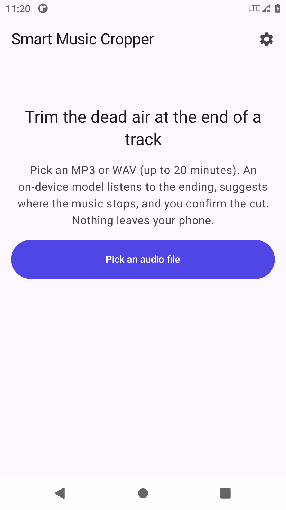
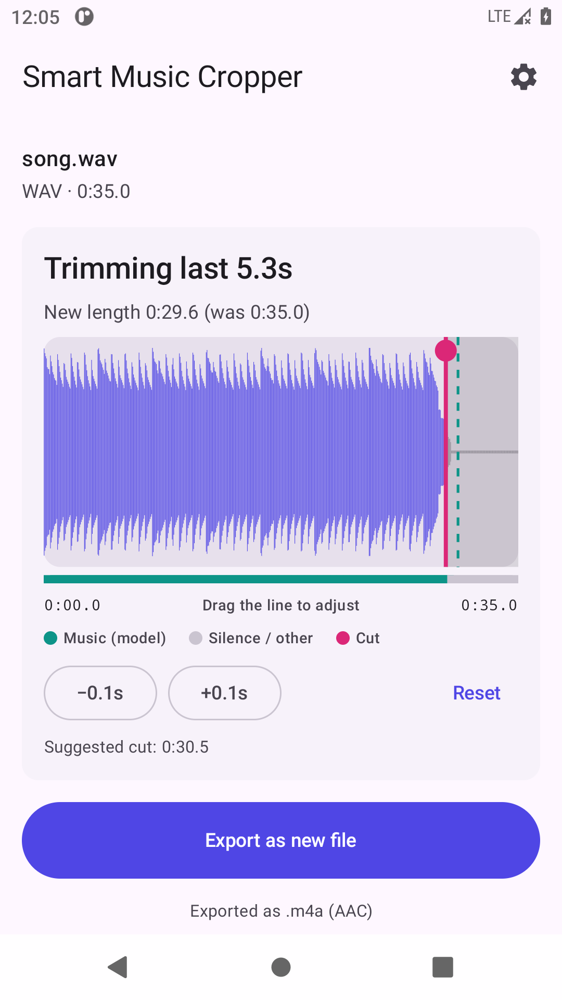
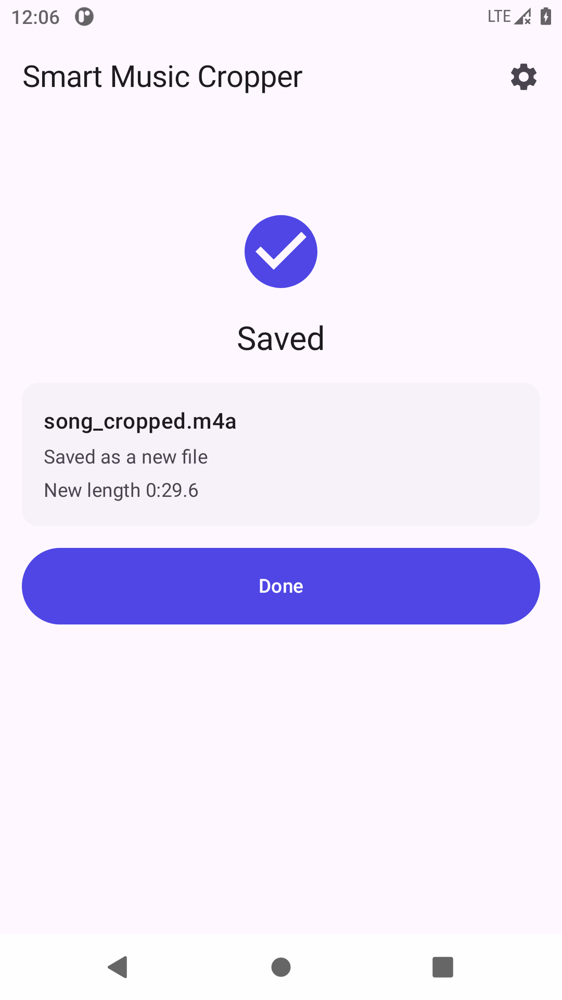

# Smart Music Cropper

An offline Android app that finds where the music actually ends in a track and trims the trailing
silence / dead air. Pick an MP3 or WAV, an on-device ML model (YAMNet via TensorFlow Lite) listens
to the ending and suggests a cut point, you confirm or drag it on a waveform, and the app exports a
cropped `.m4a`. No network access, no accounts, no analytics.

<p>
  
  
  
</p>

## Download

Grab the APK from the [latest release](../../releases/latest) and open it on an Android 8.0+
device (allow installs from your browser or file manager when asked).

## How it works

```
Pick file (Storage Access Framework)
  → decode the last ~60 s to 16 kHz mono PCM      (MediaExtractor + MediaCodec, PcmResampler)
  → YAMNet over 0.975 s windows every 0.48 s       (YamnetClassifier)
  → last window that sounds like music + 300 ms    (CropPointDetector)
  → waveform of the ending with a draggable cut    (WaveformView)
  → decode the full file and stream it into AAC,
    stopping at the cut                            (AudioDecoder → AudioEncoder → MediaMuxer)
  → save as <name>_cropped.m4a or overwrite        (FileWriter, per Settings)
```

**Music vs. not music.** Each window's YAMNet scores are summed over the music classes (everything
from "Music" through "Scary music" in AudioSet, plus singing/choir/rapping/humming) and over
silence-like classes (Silence, hiss, hum, static, white/pink noise, room tone, field recording). A
window is music when the music sum wins and is at least 0.15. Walking back from the end, the last
music window's end plus a 300 ms buffer is the suggestion. If nothing in the ending sounds like
music, the app trims nothing by default and asks you to place the cut.

**Output is always AAC in `.m4a`.** Android's MediaCodec has no MP3 encoder, so MP3 and WAV inputs
are both exported as AAC-LC (192 kbps stereo / 128 kbps mono). The UI says so next to the Export
button.

## Using it

1. Tap **Pick an audio file** and choose an MP3 or WAV (up to 20 minutes).
2. Wait a couple of seconds while the ending is analyzed.
3. Check the red cut line. Drag (or tap) to move it, use **−0.1s / +0.1s** to nudge, **Reset** to go
   back to the suggestion. The strip under the waveform shows which windows the model heard as music.
4. Tap **Export**.
   - *Save as new file* (default): a save dialog opens in the original's folder with
     `<name>_cropped.m4a` filled in.
   - *Overwrite original* (Settings, gear icon): the original's contents are replaced and, where the
     storage provider allows, it is renamed to `.m4a`. If the provider doesn't allow writing to the
     original, the app says so and asks where to save a new copy instead.

## Building

Requirements: JDK 17+, Android SDK with platform 36.

```bash
./gradlew assembleDebug          # app/build/outputs/apk/debug/app-debug.apk
./gradlew testDebugUnitTest      # JVM unit tests (resampler, detector, label map)
./gradlew connectedDebugAndroidTest   # on-device tests (needs a device or emulator)
./gradlew assembleRelease        # release APK, signed with the debug key (see below)
```

Pushing a `v*` tag runs `.github/workflows/release.yml`, which runs the unit tests, builds the
release APK and publishes a GitHub release with it attached (notes from `docs/releases/<tag>.md`).

## Project layout

```
app/src/main/java/com/example/smartmusiccropper/
  MainActivity.kt            Compose host; crop screen ⇄ settings
  MainViewModel.kt           Pipeline orchestration and UI state (survives rotation / process death)
  ui/CropScreen.kt           Picker, analysis progress, editor, export, done/error states
  ui/WaveformView.kt         Canvas waveform + draggable crop line + model strip
  ui/SettingsScreen.kt       Output mode
  audio/AudioDecoder.kt      MediaExtractor + MediaCodec → PCM (tail or whole file)
  audio/AudioEncoder.kt      PCM → AAC → .m4a; streaming trimmed export
  audio/PcmResampler.kt      Downmix + anti-aliased linear resampling
  ml/YamnetClassifier.kt     TFLite interpreter, sliding windows
  ml/CropPointDetector.kt    Music/silence heuristic and crop suggestion
  data/SettingsRepository.kt DataStore for the output mode
  files/FilePicker.kt        SAF contracts, persistable permissions, naming
  files/FileWriter.kt        New document vs. overwrite (+ fallback signal)
app/src/main/assets/
  yamnet.tflite              YAMNet classifier, float32, input [15600] @16 kHz → [1, 521] scores
  yamnet_label_list.csv      Official AudioSet class map (index, mid, display_name)
```

## Verification done for v1

- **Unit tests (JVM, 17 passing):** resampler length, chunked-equals-one-shot, in-band tone
  preserved, 12 kHz tone not aliased into the 16 kHz output, stereo channels kept apart; label map
  parsing (521 classes, quoted names); music/silence decision; crop suggestion (buffer, clamping,
  earlier pauses, no-music fallback); window placement.
- **On-device tests (Android 11 emulator, all passing):**
  - `PipelineInstrumentedTest`: real MediaCodec decode of an MP3 and a WAV (30 s of music + 5 s of
    silence). Durations match the container within 100 ms. YAMNet runs on-device and suggests a cut
    at 30.5 s, and the exported `.m4a` is AAC at that length. A corrupt file is rejected without
    crashing.
  - `EditorFlowInstrumentedTest`: drives the real activity and ViewModel. Pick → suggested cut →
    nudge → a real touch swipe on the waveform moves the line → "save as new file" writes an `.m4a`
    of the adjusted length → "overwrite original" replaces the source with the cropped `.m4a`.
    The screenshots above come from this run.
- **Model accuracy:** the exact detection pipeline (same model file, label grouping, windowing,
  thresholds, filter and resampler) was run on synthetic songs with 1 s, 5 s and 15 s of appended
  digital silence, plus 8 s of hiss and 10 s of room tone, as both WAV and 192 kbps MP3. Every
  suggested cut landed at the music/silence boundary (between 0.05 s before and 0.9 s after the
  last note).
- **Build:** debug and release APKs build cleanly, lint reports no code issues, and the arm64
  native library is 16 KB page aligned.

Not yet covered: real music recordings (tests use synthetic music), the system file picker UI on a
physical phone, other storage providers (Drive, SD cards), and airplane-mode use on hardware.

## Decisions and deviations from the build plan

- **Model file.** The TF Hub download URL for `lite-model/yamnet/classification/tflite/1` now
  redirects to Kaggle and refuses direct download, so the bundled model is Google's YAMNet
  classifier as published for MediaPipe Audio Classifier (float32, 4.1 MB, Apache 2.0). It's the
  same network, the same 521 AudioSet classes and the same `[15600]` waveform input. The label map
  is the official `yamnet_class_map.csv`, shipped as `yamnet_label_list.csv`.
- **Export streams instead of buffering.** Rather than decoding the whole file into memory and then
  trimming, decoded PCM goes straight into the AAC encoder and decoding stops at the cut. Output is
  identical; peak memory stays small. The 20-minute cap is still enforced as specified.
- **SDK levels.** `compileSdk`/`targetSdk` 36 with AGP 8.13. API 37 is out, but targeting it
  requires AGP 9, a much bigger build-system change for no user-visible benefit in v1.
- **TensorFlow Lite 2.17.0 + support 0.5.0.** These `org.tensorflow` artifacts now resolve to
  Google's LiteRT 1.0.1 runtime (same `org.tensorflow.lite` API), whose arm64 library is 16 KB page
  aligned for Android 15+ devices.
- **Picker filter is `audio/*`.** Any audio file can be picked; unsupported codecs (AAC, FLAC,
  OGG…) get a clear "MP3 and WAV only" message instead of being invisible in the picker.
- **Overwrite renames to `.m4a`** when the provider supports renaming, so an AAC file isn't left
  named `.mp3`/`.wav`.
- **Sources above 48 kHz** are resampled to 48 kHz and **sources with more than 2 channels** keep
  the front left/right pair, since AAC-LC encoders on Android reliably accept only up to 48 kHz
  stereo.
- **Release signing.** No Play Store hardening in v1: the release APK is signed with the debug key
  so it installs directly.

## Third-party

- [YAMNet](https://github.com/tensorflow/models/tree/master/research/audioset/yamnet) model and
  AudioSet class map: © Google, Apache License 2.0.
- TensorFlow Lite / LiteRT, AndroidX, Jetpack Compose, Kotlin coroutines: Apache License 2.0.
